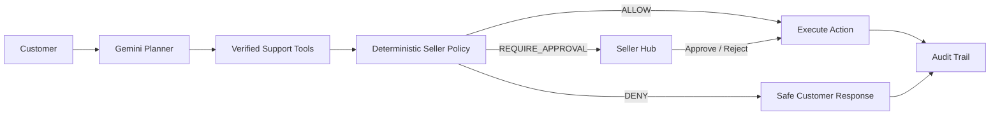

# AgentX Seller Support

<p align="center">
  <strong>Autonomous post-purchase support for online sellers — with seller-controlled guardrails for money, returns, and escalation.</strong>
</p>

<p align="center">
  <a href="https://agentx.opalx14.com"><strong>Live Demo</strong></a>
  ·
  <a href="https://agentx.opalx14.com/store">Storefront</a>
  ·
  <a href="https://agentx.opalx14.com/hub">Seller Hub</a>
</p>

<p align="center">
  
  
  
  
  
  
</p>

> **Gemini handles the conversation. Seller policy controls the money.**

AgentX Seller Support is a working autonomous support system for post-purchase commerce operations. It can understand customer requests, inspect verified order context, call support tools, create returns, request refunds, track shipments, and escalate risky actions to a human seller.

The core design principle is simple: **the language model may propose an action, but deterministic backend policy remains the authority for sensitive business decisions.**

Built for **AgentX Hackathon 2026 — PS-04: Autonomous support agent for online sellers**.

---

## Product Preview

### Storefront

Customers purchase from a demo storefront. Checkout creates real support context in the same runtime repository used by the agent.


### Autonomous Support Agent

The agent understands the request, verifies order ownership, chooses the appropriate support tool, and returns a customer-facing response.


### Seller Hub

High-risk actions cross the seller policy boundary and appear in the Hub for human review with a structured handoff summary and audit trail.


---

## The Problem

Customer support is easy to *answer* and much harder to *execute safely*.

A useful commerce agent needs permission to do more than chat. It may need to:

- inspect an order and shipment,
- create a return,
- request or issue a refund,
- decide whether automation is allowed,
- escalate to a human without losing context,
- preserve an auditable record of every action.

Giving an LLM unrestricted control over these operations is unsafe. Keeping it read-only makes it little more than a chatbot.

AgentX separates **conversation intelligence** from **business authority**.

---

## How It Works



### Responsibility split

| Layer | Responsibility |
| --- | --- |
| **Gemini planner** | Understand intent, choose the next tool, produce customer-facing responses |
| **Commerce tools** | Read verified order/shipment state and perform bounded support operations |
| **Policy evaluator** | Deterministically return `ALLOW`, `REQUIRE_APPROVAL`, or `DENY` |
| **Seller Hub** | Review actions that exceed the automation boundary |
| **Repository / persistence** | Store conversations, orders, returns, refunds, approvals, and audit events |

The model never becomes the source of truth for payment authority or seller policy.

---

## Signature Scenario

The demo's primary safety case uses **Order A1004**:

1. A customer reports damaged **Pulse ANC Headphones**.
2. The requested refund is **1,800,000 VND**.
3. The seller's automatic refund limit is **500,000 VND**.
4. Gemini selects the refund tool.
5. The deterministic policy evaluates the request.
6. Because the amount exceeds the configured limit, the result is `REQUIRE_APPROVAL`.
7. AgentX creates approval **APR-0001** and hands the case to the seller.
8. No refund is executed until the seller explicitly approves it.
9. The decision and follow-up action are written to the audit trail.

This is the key product guarantee:

> **AI can autonomously resolve routine support without being allowed to autonomously violate business policy.**

---

## Core Capabilities

### Autonomous support

- Order and shipment lookup
- Shipment tracking
- Return creation
- Refund requests
- Tool-based multi-step support flows
- Customer-visible conversation state

### Guardrails

- Customer/order ownership verification
- Deterministic refund limits
- Return-window validation
- Duplicate refund and return protection
- Human approval for high-value actions
- Human takeover and AI release controls
- Fail-closed behavior for unsafe or invalid operations

### Seller operations

- Shared conversation inbox
- Approval queue
- Order context
- Human handoff summaries
- Policy controls
- Audit history

### Channels

- Web storefront support widget
- Customer portal
- Telegram account linking and multilingual menus
- WhatsApp Cloud API adapter

Telegram localization currently includes **English, Vietnamese, and Hindi**. Internal agent/tool messages are normalized into the shared support core so channel-specific language does not duplicate business logic.

---

## Product Surfaces

| Surface | Route | Purpose |
| --- | --- | --- |
| Landing | `/` | Product overview and demo entry |
| Store | `/store` | Demo commerce storefront and checkout |
| Customer | `/client` | Customer order context and support conversation |
| Seller workspace | `/shop` | Seller-facing operations |
| Inbox | `/shop/inbox` | Conversations, takeover, release, and human replies |
| Orders | `/shop/orders` | Commerce context available to support tooling |
| Approvals | `/shop/approvals` | High-value refund decisions |
| Hub | `/hub` | Operator and policy control plane |
| Audit | `/hub/audit` | Decision and action history |
| Policies | `/hub/policies` | Refund and return policy configuration |

The repository also contains verification-oriented Hub surfaces such as scenario replay, red-team dry runs, and incident simulation. These reuse the same policy and repository primitives while avoiding unsafe production mutations.

---

## Architecture

```text
src/
├── app/                    Next.js routes and API handlers
├── components/             Store, customer, seller, hub, and shared UI
├── core/
│   ├── agent/              Gemini planner and bounded tool loop
│   ├── commerce/           Order, shipment, return, refund, approval tools
│   ├── policy/             Deterministic seller policy evaluation
│   └── domain/             Shared domain types
├── data/
│   ├── demo/               Demo configuration and guided flows
│   ├── mock/               Deterministic local commerce seed
│   ├── persistence/        Durable writes
│   ├── repository/         Shared read/write repository contract
│   └── supabase/           Server-side Supabase client
├── features/               Shipping, handoff, support, scenarios, incidents
├── platforms/
│   ├── telegram/           Bot API, linking, menus, polling runtime
│   └── whatsapp/           Meta Cloud API adapter
└── shared/                 Shared utilities

supabase/migrations/        AgentX database schema
tests/                      Product and safety regression tests
scripts/                    Smoke checks and runtime helpers
```

API route handlers are intentionally thin. Core commerce and policy behavior lives outside the HTTP layer so the same rules are reused by Web, Telegram, WhatsApp, tests, and verification surfaces.

---

## Data Model

When Supabase is configured, AgentX stores support data in dedicated `agentx_*` tables:

```text
agentx_shops
agentx_customers
agentx_orders
agentx_shipments
agentx_conversations
agentx_messages
agentx_returns
agentx_refunds
agentx_approvals
agentx_policies
agentx_audit_logs
```

The application uses trusted server-side access for privileged mutations. If Supabase is not configured, the repository falls back to deterministic process-local demo state so the complete support flow remains runnable for development and evaluation.

---

## Quick Start

### Requirements

- [Bun](https://bun.sh/) 1.2+
- Node.js-compatible runtime for Next.js 16
- Gemini API key for model-backed planning
- Supabase project if durable persistence is required

### Install

From the repository root:

```bash
bun install
```

### Environment

Create a local `.env.local` file:

```bash
GEMINI_API_KEY=your_gemini_api_key
GEMINI_MODEL=gemini-3.1-flash-lite

SUPABASE_URL=your_supabase_url
SUPABASE_SERVICE_ROLE_KEY=your_service_role_key
```

Optional channel credentials may be added for Telegram and WhatsApp when those integrations are used.

> Never expose service-role credentials or private API keys to browser code. Environment files are intentionally excluded from Git.

### Run locally

```bash
bun run dev
```

Open:

```text
http://localhost:3000
```

---

## Quality Gates

Run the full automated regression suite:

```bash
bun test
```

Static checks:

```bash
bun run typecheck
bun run lint
bun run build
```

The current suite covers the storefront, checkout, shipment tracking, human handoff, policy-driven product surfaces, Telegram account linking, multilingual Telegram menus, mock-data integrity, and signature safety scenarios.

---

## Docker

Build the production image:

```bash
docker build -t agentx-seller .
```

Run it:

```bash
docker run --rm \
  -p 3000:3000 \
  -e GEMINI_API_KEY="$GEMINI_API_KEY" \
  -e GEMINI_MODEL="gemini-3.1-flash-lite" \
  agentx-seller
```

The live deployment is currently available at:

**https://agentx.opalx14.com**

---

## Demo Notes

- Store checkout is **simulated** and does not process a real payment.
- Demo orders, customers, shipment state, and support scenarios are deterministic by design.
- Refund execution is bounded by seller policy; high-value requests require explicit human approval.
- Verification surfaces are dry-run tools and are intentionally separated from mutable production actions.

---

## Security Model

AgentX follows a few non-negotiable rules:

1. **Verify ownership before exposing order data.**
2. **Treat the model as a planner, not an authority.**
3. **Evaluate sensitive actions with deterministic policy.**
4. **Require human approval when automation crosses seller-defined limits.**
5. **Fail closed when critical verification or execution fails.**
6. **Write decisions and actions to an audit trail.**

This separation is what allows the agent to be useful without giving the model unrestricted control over money or customer data.

---

## Hackathon Context

AgentX Seller Support was built for **AgentX Hackathon 2026**, targeting:

> **PS-04 · Autonomous support agent for online sellers**

The project focuses specifically on post-purchase support automation: tracking, returns, refunds, escalation, seller policy, and auditable human control.

---

<p align="center">
  <strong>AgentX Seller Support</strong><br />
  Autonomous where it should be. Controlled where it matters.
</p>
